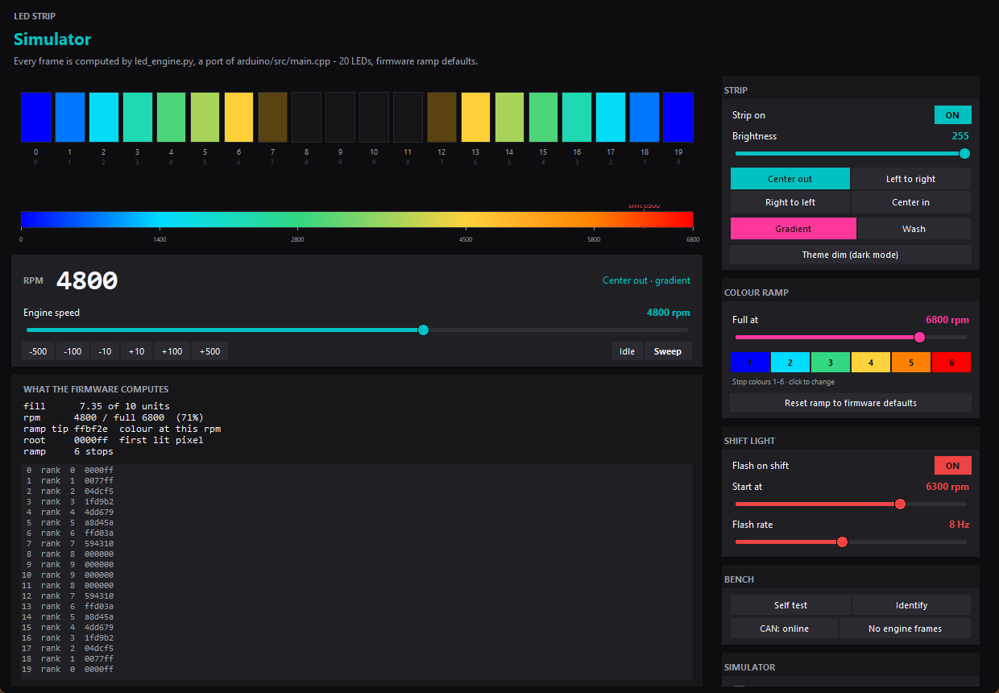

# LED strip simulator



Drag the rpm and watch the bar. Every pixel in that picture is computed by
[`led_engine.py`](led_engine.py), a line-by-line port of the LED rendering in
[`arduino/src/main.cpp`](../../../arduino/src/main.cpp) — the same 20 pixels, the same
ramp table, the same fill geometry, the same truncation.

That matters because the thing you cannot do on a bench with the engine off is judge the
colour ramp: whether a stop is in a sensible place, whether the "full at" scale makes the
bar feel quick enough, whether the shift point lands where you expect. This is the tool for
that.

```bash
python tools/simulators/led_simulator/led_simulator_v3.py
```

Windows: double-click [`LED_Simulator.bat`](LED_Simulator.bat), or run
[`run_simulator.bat`](run_simulator.bat) if you want the console output.

## What it simulates

| Control | What it does | Firmware equivalent |
|---|---|---|
| **Engine speed** | the rpm the strip is rendering | `currentRPM` |
| **Sweep** | ramps 0 → full → 0 continuously | n/a (bench convenience) |
| **Strip on** | off = the strip goes dark; decoding is unaffected | `CFG:en=` |
| **Brightness** | 0-255, applied the way `show()` applies it | `CFG:bright=` |
| **Fill pattern** | Center out / Left→right / Right→left / Center in | `SEQ:` |
| **Gradient / Wash** | per-LED gradient vs one wash of colour | `CFG:mode=` |
| **Theme dim** | dark-mode dimming (170/255) | `CFG:theme=` |
| **Full at** | the rpm at which the strip is completely lit | last `RAMP:` stop |
| **Stop colours 1-6** | the ramp itself | `RAMP:` |
| **Shift light** | start rpm, flash rate, colour | `CFG:shift/hz/scol=` |
| **Self test / Identify** | the two bench patterns | `SELFTEST`, `IDENTIFY` |
| **CAN: online / dead** | the CAN-offline pattern (two orange pixels at 1 Hz) | `!canInitialized` |
| **No engine frames** | the error scanner | `displayErrorMode` |
| **RPM smoothing** | the asymmetric filter on incoming rpm, actually applied | `readCANMessages()` |
| **LEDs** | how many pixels the strip has | `LED_COUNT` build flag |

Keys: `Up`/`Down` ±100 rpm, `PageUp`/`PageDown` ±500, `Home`/`End` for 0 and full,
`Space` sweeps, `S` cycles the fill pattern, `M` toggles the colour mode, `E` the strip,
`T` self test, `I` identify, `Esc` quits.

**RPM smoothing** runs every rendered value through the firmware's own asymmetric filter
(snap at a 250 rpm delta, no lag rising, 0.75 settling falling), so with it on the bar
chases the slider the way it chases the engine. Turn it off to see the strip's raw
response.

## Starting from the car's real settings

With the Pi reachable, this loads what the strip is actually configured with — ramp,
brightness, fill pattern, colour mode, shift light — so you are looking at your car rather
than at the defaults:

```bash
python led_simulator_v3.py --pi 192.168.42.100:5000
# with a token if the API requires one
python led_simulator_v3.py --pi 192.168.42.100:5000 --token <token>
# or set MX5_WEB_TOKEN
```

It reads `GET /api/status` once and applies the `led_*` keys. Nothing is written back: this
is a viewer, so it cannot change the car.

## How "identical" is proved

Reading the firmware and retyping it in Python is how a port drifts: a cast in the wrong
place, a `<` that should be `<=`, a float where the C is an integer. So this is checked two
ways, both mechanically, both able to fail.

### 1. The logic: the firmware's own code is compiled and diffed

```bash
python tools/simulators/led_simulator/parity_check.py --mutate-check
```

`parity_check.py` **extracts the source text** of the rendering functions out of
`arduino/src/main.cpp` — `rampColorAtRpm`, `barRank`, `barSlots`, `renderBar`,
`drawCanOffline`, `drawSelfTest`, `updateErrorAnimation`, `updateLEDs`, and
`readCANMessages` — drops them into a small C++ program with stubs for the Arduino bits, and
compiles it with MSVC. Then it runs 371 cases (every fill pattern, both colour modes, dim on
and off, five "full at" scales, four ramps, the idle/shift/offline/error/self-test states,
the frame boundaries and 120 random combinations) through both that binary and the port, and
requires **every pixel of every frame to match exactly**. It also compares the rpm decode
and smoothing filter reading-for-reading, and the NeoPixel brightness scale value-for-value.

Because the C++ side is extracted rather than copied, editing the firmware without touching
the port makes it fail.

`--mutate-check` proves the comparison has teeth: it perturbs the port (`DIM_SCALE` by one,
then `_byte` by one) and fails if the frames *don't* diverge. A check that passes because
both sides are inert is worse than no check. Verified: a one-unit change to either is
caught, and nudging `RPM_ALPHA_FALLING` from 0.75 to 0.90 produces
`rpm 2500: C++ 2525, python 2510`.

Missing a compiler? It reports `SKIPPED` and exits 0, so it can sit in a test run on a
Python-only machine. Point `MX5_CL` at a `cl.exe` if MSVC is somewhere unusual.

### 2. The settings: every copy of every number is parsed and compared

```bash
python tools/simulators/led_simulator/test_settings_parity.py
```

**51 settings** are parsed out of the four places that hold a copy and compared: the
firmware's constants and `CFG:` clamps, the Pi's `Settings` defaults and its validation
ranges, the phone's sliders and ramp fractions, and the simulator's own defaults and slider
ranges. It found three real disagreements, all now fixed:

| Disagreement | Was | Now |
|---|---|---|
| Simulator shift-light slider | 3000-8000 | **2000-8000**, the firmware's clamp |
| Phone shift-light slider | 3000-7500 | **2000-8000**, the firmware's clamp |
| Phone brightness fallback | 180 (invented) | **255**, the strip's boot value |

It is not vacuous: drifting `DIM_SCALE` to 169 makes it exit 1 and name the firmware line.

### 3. What is deliberately *not* modelled

Nothing here changes a pixel, but claiming "identical" without saying this would be
overclaiming:

| Not simulated | Why |
|---|---|
| The startup animation | A boot sequence, not a state you can select. It has its own issue ([ISSUE-07](../../../docs/KNOWN_ISSUES.md)). |
| The 3 s error debounce (`ERROR_DEBOUNCE_MS`) | "No engine frames" switches the scanner on immediately, because that is what you want on a bench. The firmware waits 3 s first. |
| `DEMO:<rpm>` and its 60 s self-clear | The rpm slider is the override; there is no second one to expire. |
| The brightness pot on `A6` | `ENABLE_BRIGHTNESS` is on and the pin floats on this build, so until the Pi sends `CFG:bright` the real strip's brightness can disagree with any slider. The simulator shows the value the strip is *told*. |
| `showIfChanged()` and the repaint gate | Performance only: they skip work, not pixels. |
| `LED_COUNT` as a build flag | Defaults to 20; the **LEDs** slider covers 5-60 for a strip that was cut or extended. |

## Reading the screen

- **The strip** is the physical order, pixel 0 at the left. The small number under each
  pixel is its *rank* — how far along the fill it sits — which is what the four fill
  patterns actually change.
- **The gradient bar** under it is the ramp itself, with the stop rpms marked and the shift
  point drawn as a dashed line. A stop that never gets reached, or two stops out of order,
  shows up here without touching the rpm at all.
- **What the firmware computes** is the arithmetic behind the current frame: the fill in
  LED units, the fractional tip, the colour at the present rpm, and a per-pixel dump you
  can compare against a real strip read back over serial.

## Legacy versions

`led_simulator.py`, `led_simulator_v2.py` and `led_simulator_v2.1.py` are kept for
reference only and are **superseded**. They simulate a six-state LED program (white pepper
inward, steady green edges, orange stall pulse, yellow bar, red flashing gap, solid red)
that lived in the old `lib/LEDController` architecture and no longer exists in the shipping
firmware. They also drive a gearbox/physics model rather than the current ramp, and they
read `lib/Config/LEDStates.h`, which nothing builds any more.

Use `led_simulator_v3.py`. If you need the physics model back for a different purpose, it is
still there — but do not trust its LED output.
