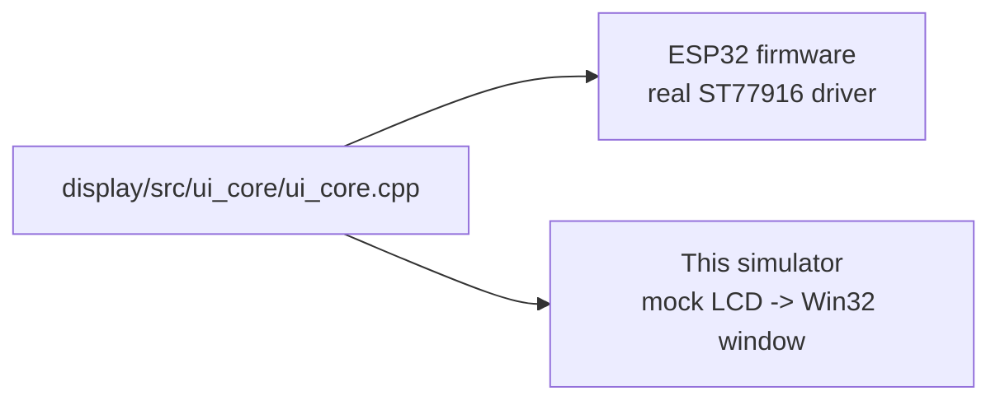

# Native ESP32-S3 Display Simulator

Runs the **actual** ESP32 UI code on Windows — no Python re-creation.

The simulator compiles `display/src/ui_core/ui_core.cpp` (the single source of
truth for the display UI, also compiled into the firmware) against a mock
`LCD_*` backend that draws into a 360x360 framebuffer and shows it in a Win32
window.



**Edit `display/src/ui_core/ui_core.cpp` and both the device and this simulator
change.** The only difference is the rendering backend.

## Requirements

- Windows + Visual Studio Build Tools (MSVC C++ workload). The build script
  locates it automatically via `vswhere`.

## Run

```bat
tools\simulators\native\run.bat         rem build + launch interactive window
tools\simulators\native\screenshot.bat  rem render every screen to shot_0..7.bmp
tools\simulators\native\startup.bat     rem render the power-on sequence (see below)
```

The interactive window plays the **real power-on path**: the 22 s (`UI_BOOT_ANIM_MS`)
startup film, then the rest of the `PI_BOOT_COUNTDOWN` (30 s) with the boot screen
still running — filling ring, orbiting comet, breathing emblem, rotating loading message
and the seconds remaining — then the live Overview. **Enter/Space** ends the wait early
("the Pi came up"), **B** replays the whole thing, **P** kills the Pi link (5 s later the
link-lost screen takes over) and restores it.

`startup.bat` (or `esp32_ui_simulator.exe --startup`) renders the whole
power-on path to stills:

| File | What it is |
|------|------------|
| `boot_00..28_*.bmp` | 29 frames across the whole intro, filename carries the timestamp |
| `startup_frames\f*.bmp` | the 22 s intro at 12.5 fps, for a film/GIF |
| `wait_00_intro8s … wait_03_over.bmp` | mid-film, the wait at 6 s, the wait at 2 s, and after the countdown expires with no Pi |
| `startup_frames_wait\w*.bmp` | the whole 30 s power-on at 1 fps (31 frames) |
| `live_0_overview.bmp` | the first live frame, once telemetry arrives |
| `linklost_dark.bmp`, `linklost_1m.bmp`, `linklost_light.bmp` | the link-lost screen 4 s and 70 s after the last packet, and in the light theme |
| `linklost_sweep_0..3.bmp` | four phases of the radar sweep, for checking the trail without the window |
| `boot_light_film.bmp`, `boot_light_impact.bmp`, `boot_light_final.bmp`, `wait_light.bmp`, `live_light.bmp` | the same beats in the light theme (the flash inverts: a white core is invisible on a near-white page) |

`esp32_ui_simulator.exe --themes` renders the burst, the impact and the final frame
for **all twelve stored colour schemes**, dark and light (`theme_<n>_<id>_<mode>_*.bmp`),
which is how the scheme-awareness of the opening is checked:

```
theme_00_aurora_dark_impact.bmp
theme_01_crimson_dark_impact.bmp
...
theme_11_neutral_light_final.bmp
```

To render the **reversing** case (speed −3 km/h, gear R) instead of the default
45 km/h forward demo, run the binary directly:

```bat
esp32_ui_simulator.exe --screenshot --reverse   rem writes rev_0..7.bmp
```

That is the regression view for the sign of the speed: the Overview and RPM pages
must show a negative number beside the `R`, and the gear ladder must read `REVERSE`.
In the interactive window `[` lowers the speed below zero for the same check.

`--stale` renders the link-lost state instead - the Pi was streaming and then went
quiet. That screen is a *takeover*: it is drawn instead of whatever screen is
selected, so all eight `stale_0..7.bmp` files show the same waiting animation. The
only thing that differs between them is where the radar sweep happens to be.

```bat
esp32_ui_simulator.exe --screenshot --stale     rem writes stale_0..7.bmp
```

In the interactive window, `P` kills the Pi link and `P` again restores it. The kill is
faithful: the dashboard holds its last readings for the full `PI_LINK_TIMEOUT_MS` (5 s) and
then the takeover screen appears, which is exactly what the panel does.

`--speed=<kmh>` overrides the demo road speed, which is how the Overview gear ladder is
checked where its predicted RPMs run to five digits:

```bat
esp32_ui_simulator.exe --screenshot --speed=112 rem motorway: 1st = 14141, 2nd = 8530
```

Or use the VS Code tasks **ESP32-S3 UI: Native Simulator (Run)** /
**(Screenshots)**.

## Controls

| Key | Action |
|-----|--------|
| Up / Down / Left / Right | previous / next screen |
| 1 – 8 | jump to screen (1 = Overview … 8 = Settings) |
| Enter | select / toggle the currently selected Settings item |
| + / - | RPM up / down |
| [ / ] | speed down / up |
| G | cycle gear (N, 1-6) |
| E | toggle engine running |
| C | toggle clutch |
| L | toggle navigation lock |
| B | replay power-on (animation + Pi wait) |
| Enter / Space | end the Pi wait early, as if the link came up |
| H | print help |
| Esc | jump to Overview |
| Q | quit |

## How it stays in sync

The UI core is hardware-agnostic. All drawing goes through the `LCD_*` API:

- **On device:** `Display_ST77916.h` / `Display_ST77916.cpp` (real QSPI driver).
- **In the simulator:** `native_display.h` / `native_display.cpp` (mock that
  writes RGB888 into a framebuffer, with the same text metrics / font as the
  device).

`ui_core.h` picks the backend automatically:

```cpp
#ifdef UI_CORE_NATIVE
  #include "native_display.h"
#else
  #include "Display_ST77916.h"
#endif
```

The power-on path is part of that core too: `ui_startupFrame(t, seek)` and
`ui_bootWaitFrame(el)` in `ui_core/ui_core.cpp`. The firmware drives them from
`millis()` in `display/src/main.cpp`, the harness drives them from the same
clock on the desktop, and `seek = true` / the idempotent wait frame repaint the
state at any timestamp from a clean screen so stills can be captured.

## Files

```
tools/simulators/native/
  build.bat             locate MSVC + compile
  run.bat               build + launch interactive window
  screenshot.bat        build + render all screens to BMPs
  startup.bat           build + render the power-on sequence to BMPs
  native_main.cpp       Win32 harness, keyboard input, demo telemetry
  native_display.cpp    mock LCD_* backend + 5x7 font + framebuffer
  native_display.h      mock LCD API
  native_platform.h     minimal Arduino shim (millis, constrain, Serial, ...)
```
